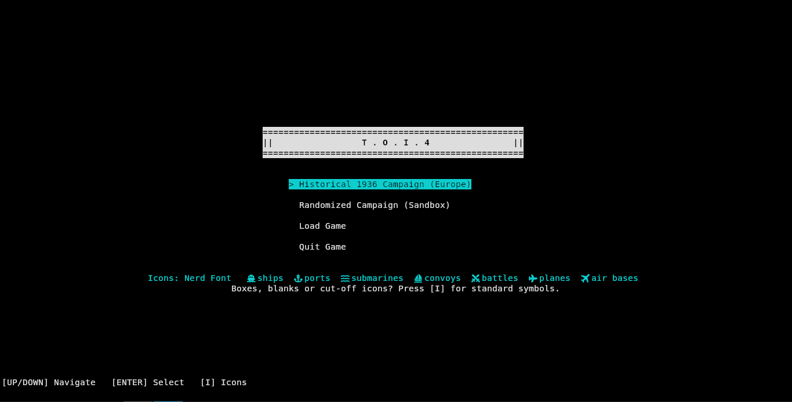
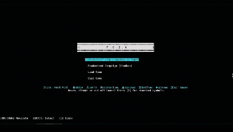
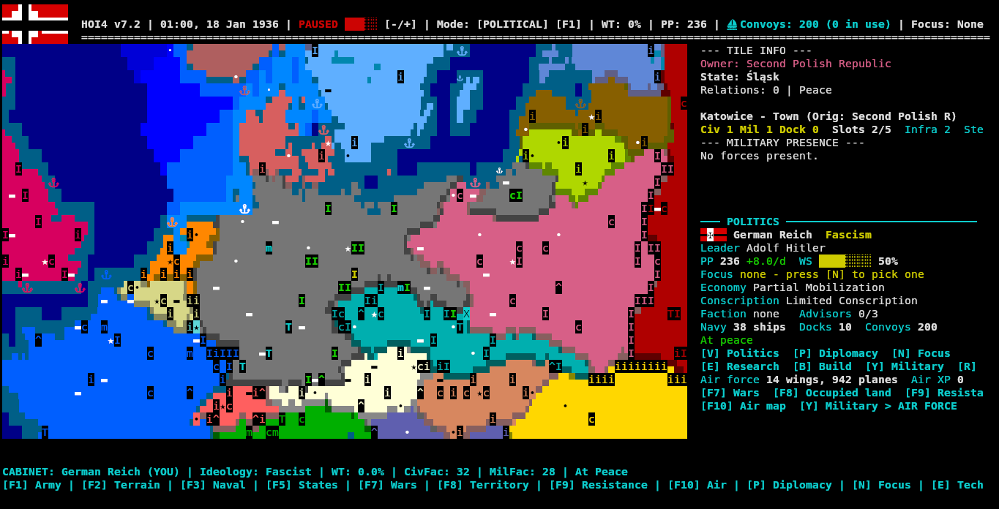

# TOI4



A offline-vibecoded terminal Hearts Of Iron IV copy


## 𝗣𝗿𝗲𝗿𝗲𝗾𝘂𝗶𝘀𝗶𝘁𝗲𝘀
* For compatibility its recommended to use **Linux** but it will work for any operating system **with a working Python 3 install**. (Including **Windows**) .

* It is recommended to use a [Mono Font](https://github.com/JetBrains/JetBrainsMono) but it is optimized to work with nearly every font.

* For your terminal its very recommended to use one with 256 colors like [Kitty](https://github.com/kovidgoyal/kitty) etc.

* It has not been tested to work with older Python versions so use the **Latest Python package**.




---

## Installation for the Unix family (Macos included)

### 1. Clone the repo
```bash
git clone https://github.com/redrandomcoreguy/TOI4.git
cd TOI4
```

### 2. Run the install script

```bash
chmod +x install.sh
./install.sh
```

**NixOS:** Add `python3` and `gcc` to `environment.systemPackages`, run:
```bash
sudo nixos-rebuild switch
```
then run `sh install.sh` again.

#### Doing it by hand instead

Install Python 3 and a C compiler with your package manager before running `sh install.sh`; the script skips that step when it finds them. It also adds `~/.local/bin` to your `PATH`. To do that yourself, put this line in your shell's startup file (`.zshrc`, `.bashrc`, `~/.bash_profile` on macOS, or `~/.profile`):
```bash
export PATH="$HOME/.local/bin:$PATH"
```
---
## Installation for Windows 

### 1. Install Python 

Download **3.14** from [Here](https://www.python.org/downloads/windows/) and click **"Add python.exe to PATH"** in the installer.

### 2. Download the files

On the GitHub click **Code > Download ZIP** and **extract** it.

### 3. Run the install script

Open the folder and run **`install.bat`**.

---

**Once you are done installing run `toi4` to play it!**



---

### Command flags
| Flag | Usage  |
| :--- | :--- |
| `toi4 --help` | Prints a help menu |
| `toi4 --icons plain` |  Uses normal symbols for the map/game icons and uses the choice |
| `toi4 ---icons nerd` |  Uses Mono Nerd font icons (on windows it defaults to normal) |
| `toi4 --install` | Runs/makes the toi4 command |
| `toi4 --uninstall` | Removes the toi4 command |
| `toi4 --update` | Updates the game files |
| `toi4 --updates off` | Turns off update reminders and stops checking Github |

